# 使用手册

面向同学、班委与管理员的操作说明。部署、配置与运维见 [部署与运维](serve.md)。

> 文中的截图取自演示环境，姓名为虚构数据。界面上的班级名称、院系、校徽由部署方配置，
> 不同班级看到的文字会不一样，布局与操作是一致的。

## 目录

- [1. 登录与账号](#1-登录与账号)
- [2. 界面导览](#2-界面导览)
- [3. 首页与我的信息](#3-首页与我的信息)
- [4. 通知公告](#4-通知公告)
- [5. 投票表决](#5-投票表决)
- [6. 文件公开与资料下载](#6-文件公开与资料下载)
- [7. 办事中心](#7-办事中心)
- [8. 班级管理](#8-班级管理)
- [9. 系统管理](#9-系统管理)
- [10. 消息通知](#10-消息通知)
- [11. 常见问题](#11-常见问题)

---

## 1. 登录与账号

### 1.1 密码登录

在浏览器打开系统地址，未登录时看到登录页：

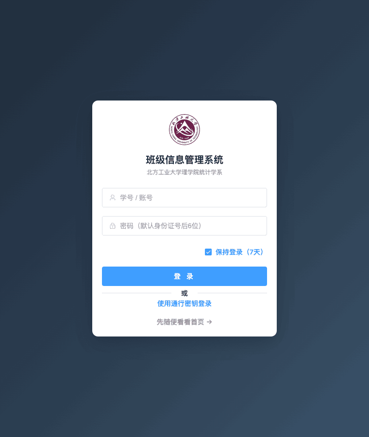

- 账号：学生填**学号**，管理员填部署时约定的账号。
- 密码：初始值是**身份证号后 6 位**；没有身份证号的学生，用**学号后 6 位**。
- 「保持登录（7 天）」默认勾选。公用电脑上建议取消勾选，离开时点「退出登录」。

登录失败不会直接告诉你「账号不存在」还是「密码错误」，统一提示「学号或密码错误」。
同一台机器在 10 分钟内输错一次，登录框下方会出现人机验证；累计失败次数达到阈值，
该出口 IP 会被临时封禁，页面会写明解封时间。

### 1.2 通行密钥（免密登录）

通行密钥用手机指纹、面容或电脑的 Windows Hello 代替密码。这是一个可选功能：
没有登记过的人照常用密码登录，系统不会要求你配置，也不会拿它打断登录；
在没登记过钥匙的设备上点这个入口，只会提示「没有可用的钥匙」。

登记过钥匙的设备，登录页下方会出现与「登 录」同样大的「使用通行密钥登录」按钮：

1. 点按钮，系统会列出这台设备上属于本站的钥匙（只有一把时可能直接验证）；
2. 按系统弹窗完成指纹 / 面容 / PIN 验证即可，**不用先输学号**。

支持自动填充的浏览器里，还有更快的走法：聚焦「学号 / 账号」输入框，钥匙会直接
出现在自动填充里，选中后再验证一次即可 —— 不会弹出任何窗口。

钥匙里本身带着账号，服务器凭它认出是谁。钥匙的私钥只保存在你自己的设备里，
服务器只存公钥。**密码始终有效**，钥匙丢了、换了手机，照常用密码登录，
再到「我的信息 → 账户设置 → 账号安全」删掉旧钥匙、登记一把新的。

浏览器不支持，或不是通过 HTTPS 访问（本机调试除外）时，这个入口不会出现。

### 1.3 二次验证

二次验证是可选功能，默认关闭。开启后，密码正确还要再输一个 6 位验证码：

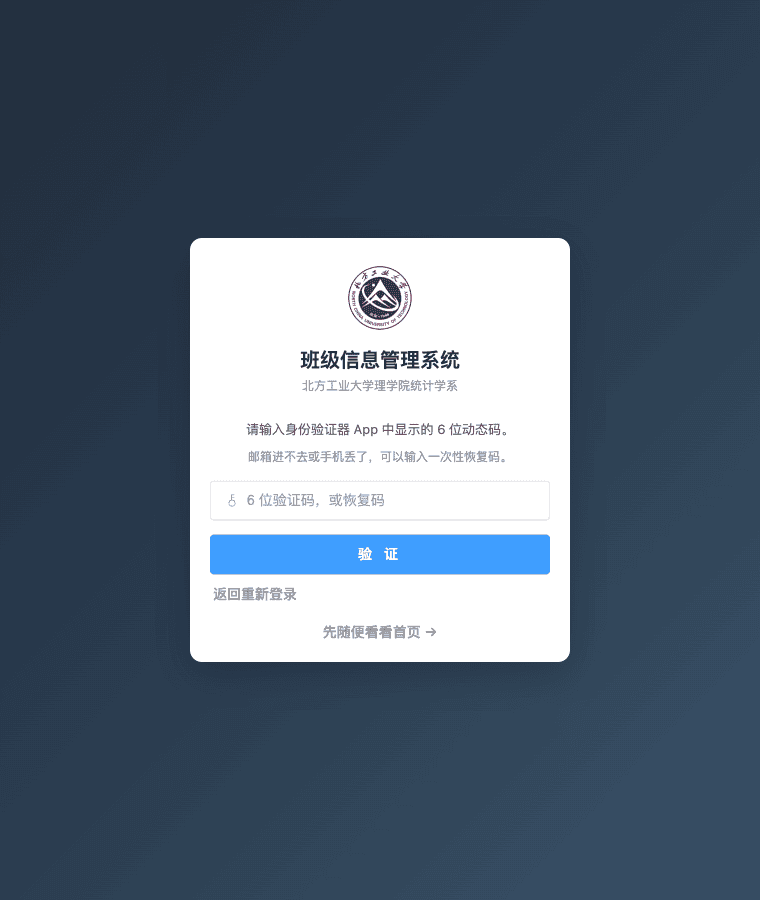

两种方式二选一：

| 方式 | 验证码从哪来 | 前提 |
|---|---|---|
| 电子邮件验证码 | 发到「通知设置」里那个邮箱，10 分钟有效 | 管理员已配置发信服务（SMTP） |
| 身份验证器（TOTP） | Google Authenticator、微软 Authenticator 等 App 生成，30 秒一换 | 手机时间准确 |

开启方法见 [3.3 账户设置](#33-账户设置)。开启时会生成 **10 个一次性恢复码**，
请在当场的弹窗里抄下来或存进密码管理器——它只显示一次。邮箱进不去、手机丢了时，
在验证码框里填恢复码即可登录，每个恢复码只能用一次。

通行密钥登录**不经过**二次验证：钥匙本身已经要求设备上的验证。

### 1.4 首次登录与忘记密码

用初始密码登录成功后，会弹出关不掉的「设置新密码」窗口。新密码要求 **6～32 位，
且同时包含字母和数字**。改完之后旧的初始密码立即失效。

系统不提供自助找回密码。忘记密码时请联系管理员，在「系统管理 → 账号管理」里
重置为初始密码，再用新密码登录并按提示改掉。

---

## 2. 界面导览

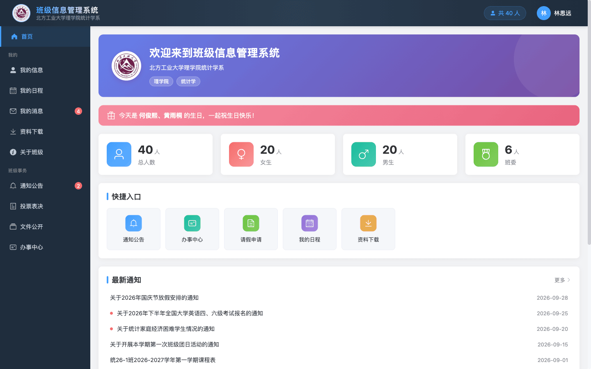

登录后界面分四块：

- **顶栏**：校徽、系统名称、全班人数、当前登录人。
- **左侧菜单**：按「我的」「班级事务」「班级管理」「系统管理」分组。
  菜单只列出当前账号有权限的功能，看不到就是没有权限。
- **工作区**：当前页面的内容。
- **页脚**：班级署名与学校链接。

手机端会把菜单收进抽屉，表格改为可横向滑动。页面可以「添加到主屏幕」，
从桌面图标打开时接近原生应用：

  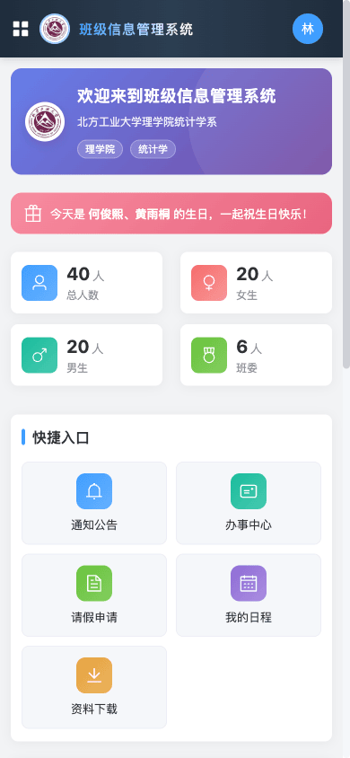
  &nbsp;&nbsp;
  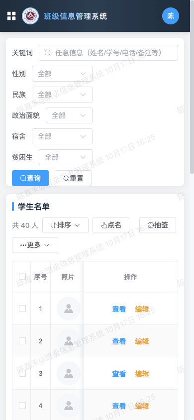

---

## 3. 首页与我的信息

### 3.1 首页

首页显示：班级总人数、男女人数、班委人数；有人过生日时的祝福条幅
（未登录只显示人数，登录后才显示姓名）；快捷入口；最新通知。

### 3.2 我的信息

「我的信息」一个页面分四块：

- **基本信息**：学号、姓名、性别、民族、宿舍、联系方式等。信息不对时点「申请修改」，
  提交后由班委审核，通过后才真正生效。可申请修改的字段包括 QQ、邮箱、
  本人电话、家庭电话、家庭地址、邮编、团学会职务、床位号。
- **我的成绩**：只显示自己的各科分数。缺考、免修、缓考、违纪会以标记显示。
- **账户设置**：账号安全、通知设置、我的日志。
- **办件空间**：自己提交过的请假、通行证、证明与反馈。

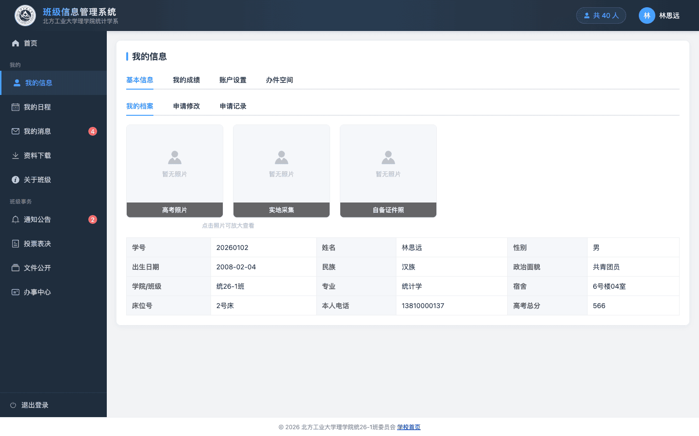

### 3.3 账户设置

**账号安全**里有四件事：修改密码、访问令牌、通行密钥、二次验证。

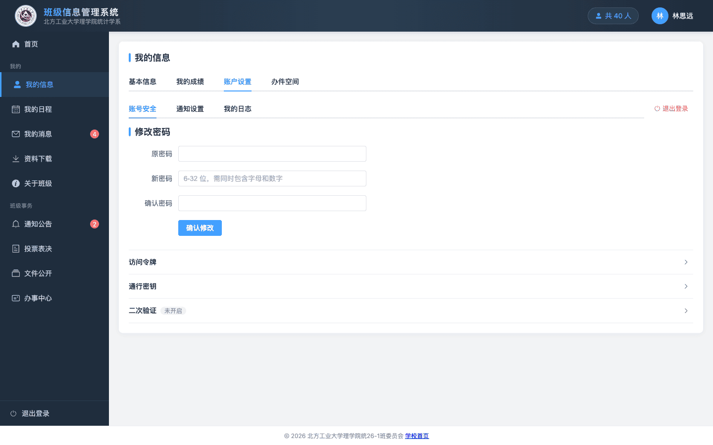

- **修改密码**：填原密码、新密码、确认密码。改完旧密码立即失效。
- **访问令牌**：给脚本、MCP 这类外部程序用的长期凭据。创建时只显示一次，
  请当场保存；不用的令牌及时吊销。令牌一律按普通学生权限使用，与你的角色无关。
- **通行密钥**：用指纹、面容或 Windows Hello 登录，见 [1.2](#12-通行密钥免密登录)。
  添加时需要先输一次登录密码；列表里能看到添加时间与最后使用时间。

  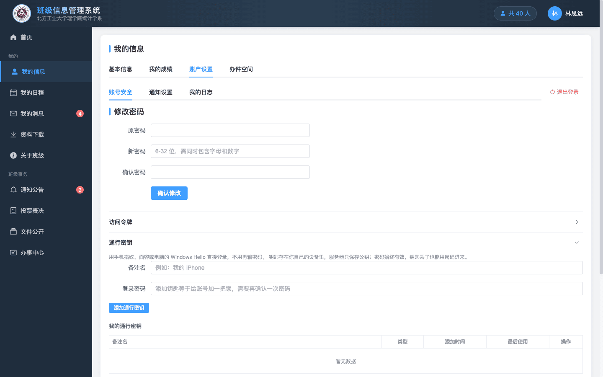

- **二次验证**：开启后密码登录多一道 6 位验证码，见 [1.3](#13-二次验证)。
  可以随时关闭；「重新生成恢复码」会让旧的一批全部作废。

  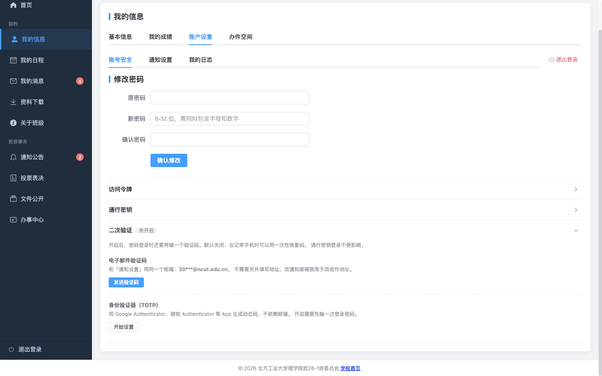

**通知设置**决定消息除站内之外还往哪里推：浏览器通知、Bark、邮件、自定义 Webhook
（后两个需要管理员先在服务端配置）。每个渠道都有「发送测试」，能收到才算配置成功。
站内信始终照常记录，任何渠道配置错误都不会导致漏消息。

**我的日志**分两张表：上面是自己做过的操作；下面是登录与账号操作记录
（登录成功 / 失败、改密码、令牌创建与吊销等），保留最近 7 天。

### 3.4 我的消息

所有推送给自己的消息都会汇总到「我的消息」：通知公告、办件进度、审核结果、
成绩发布、生日祝福。未读消息左侧有蓝点，可以一键全部标为已读。

### 3.5 我的日程

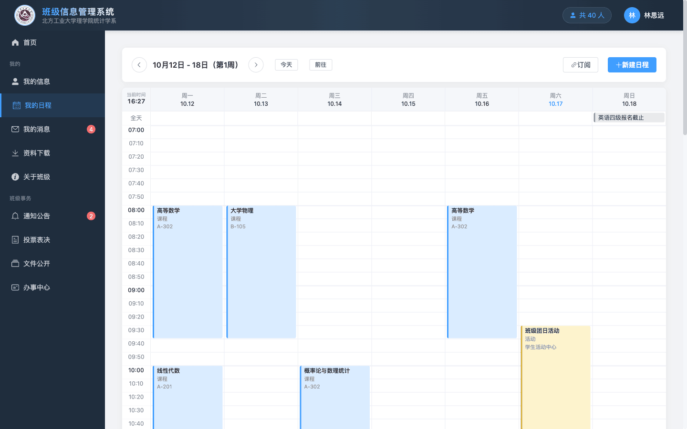

按周显示课程、会议与活动。点卡片先看详情，再决定是否编辑。可以订阅成 iCal 链接，
同步到手机日历；日程提醒与订阅入口都在这一页。
班委可以导入课表 Excel，也可以把一条日程分配给指定学生。

---

## 4. 通知公告

### 4.1 阅读

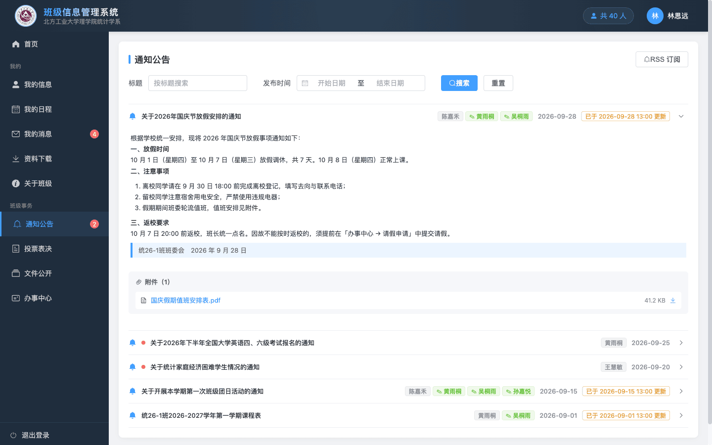

列表显示标题、发布人、发布日期与未读标记。点开一条查看正文与附件；
通知的附件**不要求登录**也能下载，方便转发给家长或班级之外的人。

登录后可以在「通知公告 → RSS 订阅」里取一条私有链接，加进任意 RSS 阅读器
（Feedly、Inoreader、Reeder 等）订阅新通知。链接里的令牌与「我的日程」
共用同一个，在日程页重置会让两侧一起失效。

### 4.2 发布与编辑（班委）

点右上角「发布通知」，填写标题与正文。正文支持 Markdown（标题、加粗、列表、表格、
引用），可以加最多 3 个附件，单个不超过 20MB。

可见范围分两种：

- **全体公开**：所有登录用户都能看到，并出现在首页「最新通知」。
- **仅班委**：普通学生看不到这条通知。

已发布的通知可以编辑，编辑记录会保留在通知详情里。

### 4.3 已读名单与提醒

班委点开一条通知的「已读情况」，能看到谁已读、谁还没读，并一键提醒未读的人。
冻结账号与提醒人自己会被跳过。

---

## 5. 投票表决

### 5.1 列表

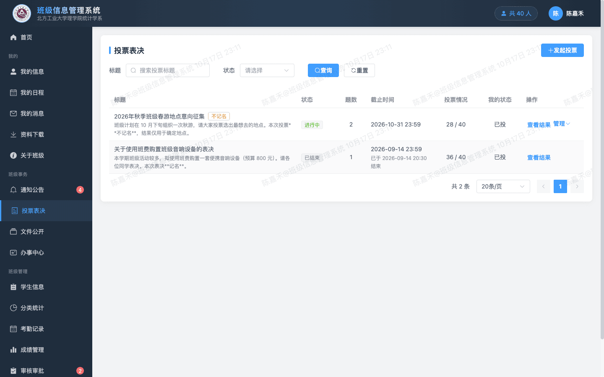

一场投票一行：标题、状态、题数、截止时间、投票情况与我的状态。
状态由开始与截止时间自动判定：未开始 / 进行中 / 已结束。

「我的状态」写着我在这一场里的处境：待投票、已投、无需投票、未开始。

### 5.2 发起投票（班委）

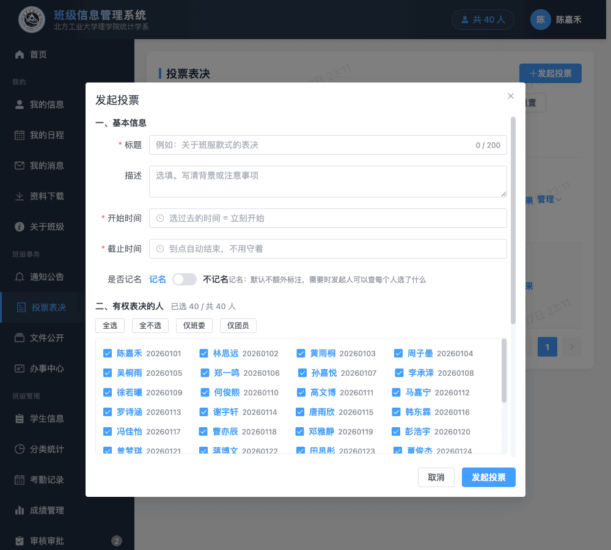

出卷界面分三段：

1. **基本信息**：标题、说明、开始时间、截止时间、是否记名。
   开始时间填过去的时间即立刻开始；截止时间到点自动结束。
2. **有权表决的人**：默认全班，可用「仅班委」「仅团员」一键切换，也可逐个勾选。
3. **题目**：每题单选或多选；多选可限制最多选几项；每题最多 20 个选项。
   每题都必须作答，想让同学表达「都不赞成」，请把「弃权」单独列成一个选项。

如果这次的题目与以前某场投票相近，可以用「从之前的投票复制题目」整卷复制，
再在此基础上修改。**只复制题目**，标题、时间、范围与记名方式仍按本次填写；
表单里已有题目时会先确认是否覆盖。

投票进行中，发起人随时能看实时票数；其他参与人要等投票结束才看得到结果。
不记名投票在接口层就不返回「谁选了什么」，只保留「谁投了 / 谁还没投」用于催票。

### 5.3 参加表决

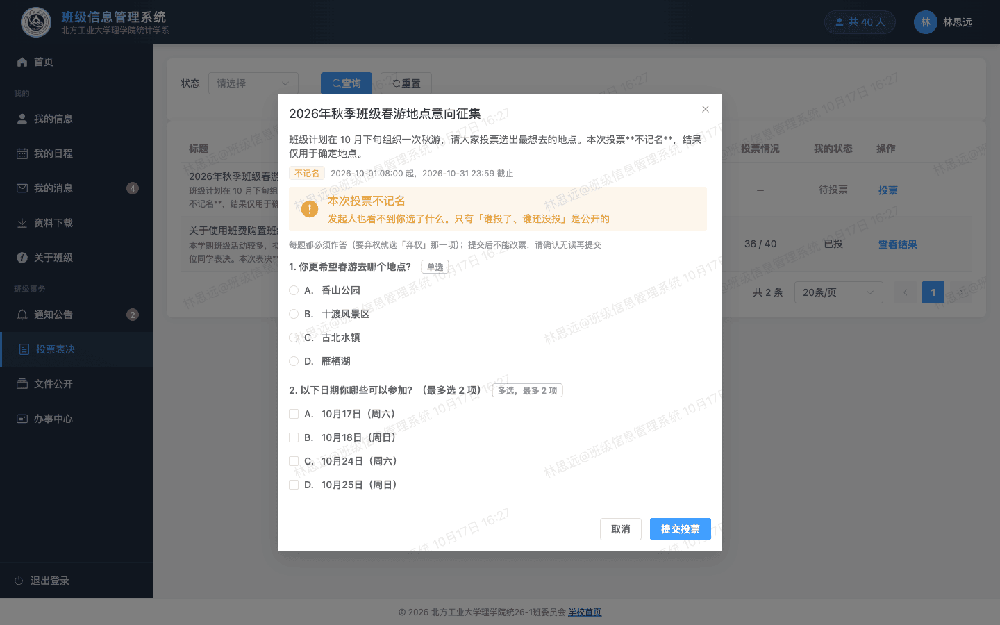

逐题作答，全部答完才能提交。提交前会再确认一次；**提交后不能改票、不能重投**。

### 5.4 结果与投票名单

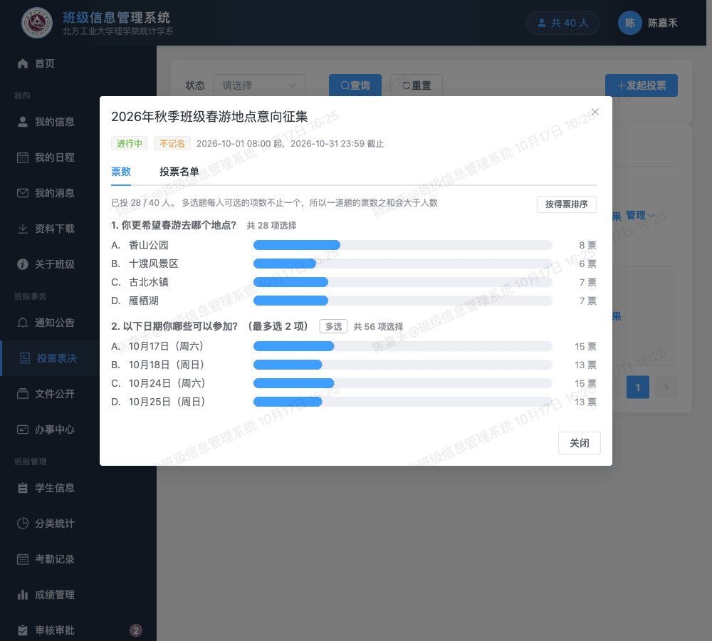

结果分「票数」与「投票名单」两个页签。投票名单只有发起人与管理员看得到；
不记名投票只显示投没投，不显示选了什么。发起人可以催票或提前结束投票。

---

## 6. 文件公开与资料下载

- **文件公开**：公告类 PDF。普通学生只能看到「全体公开」的文件；
  班委可以上传、下载与删除。文件被删除时，它的查看与下载记录一并清理。
- **资料下载**：校徽、打印名单、常用表格等公共文件，由管理员在
  「系统管理 → 资料下载管理」里维护，可上传、改名、调序、删除。

---

## 7. 办事中心

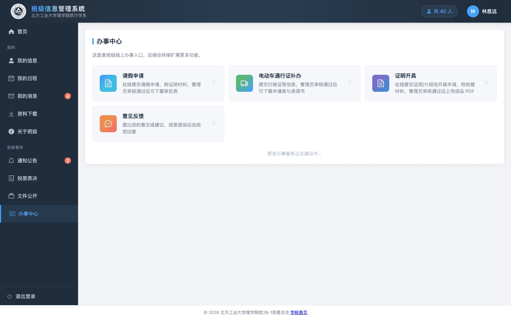

四类办件：请假申请、电动车通行证补办、证明开具、意见反馈。
每类页面顶部写明「办件介绍」「提交材料」「办结材料」与办结时限。

### 7.1 请假申请

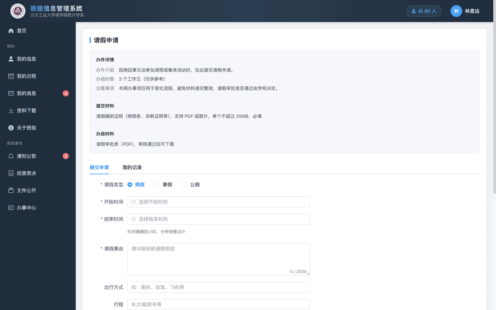

填请假类型（病假 / 事假 / 公假）、起止时间、事由、出行方式与行程，
并上传请假辅助证明（病假条、诊断证明等，单个不超过 20MB，必填）。
提交后在「我的记录」里看进度：

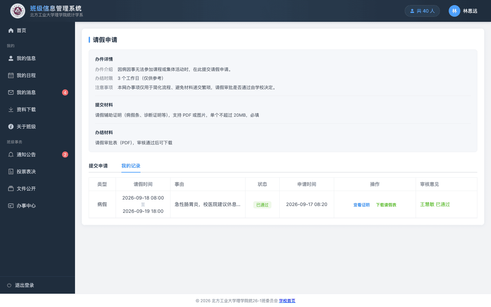

状态依次为：待受理 → 已受理 → 待补正 / 已通过 / 已驳回。
未受理之前可以修改或撤销；受理之后不能改。批准后可以下载带签字的请假审批表 PDF。

### 7.2 电动车通行证补办

提交品牌、车牌号与行驶证照片。批准后可以下载通行证申请表与承诺书。

### 7.3 证明开具

填证明标题、接收单位与正文，可附材料。管理员办结后，成品 PDF 出现在你的记录里，
随时可以重新下载。

### 7.4 意见反馈

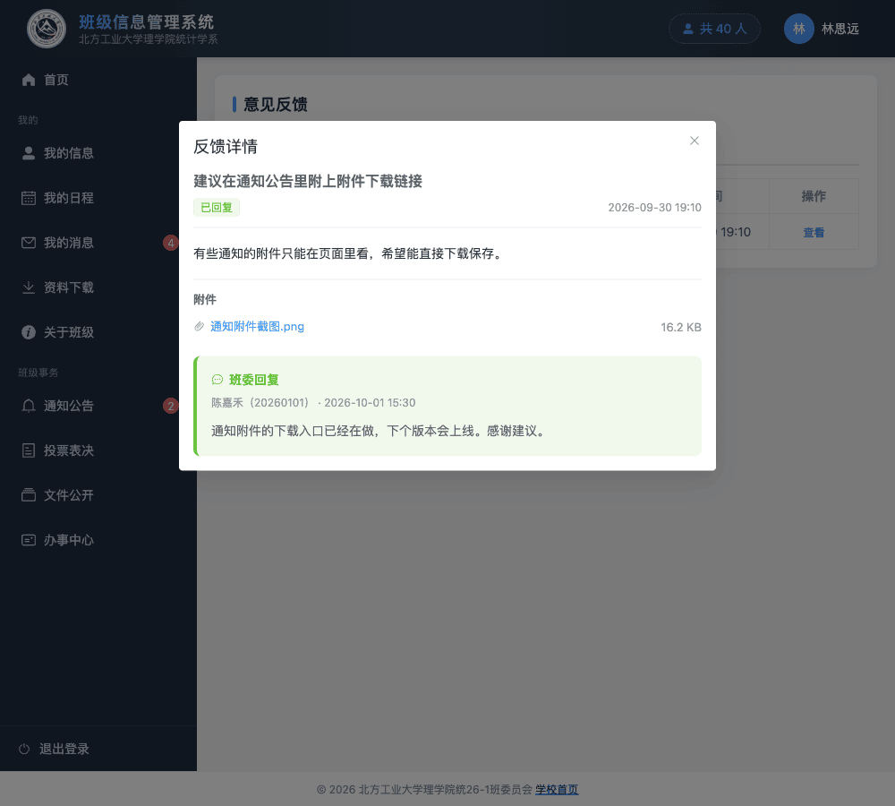

反馈可以带附件，班委会回复。回复后可以继续查看详情。

> 请假、证明、通行证的**批准 / 驳回**只有管理员能做；班委能看列表、看附件、回复反馈。

---

## 8. 班级管理

以下功能对班委开放，管理员拥有全部权限。

### 8.1 学生名单

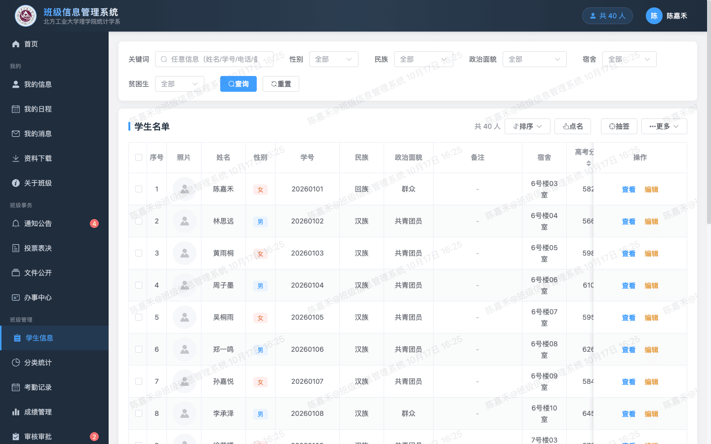

- 按关键词、性别、民族、政治面貌、宿舍、贫困生筛选；表头可排序。
- 点「查看」打开学生详情，点「编辑」修改信息（管理员可改全部字段，班委只读并改备注）。
- 工具条上的「点名」「抽签」用于课堂点名与随机抽人；其余低频操作收在「更多」里。
- 含名单与审批记录的页面盖有「姓名@班级 日期」的溯源水印。

### 8.2 点名与考勤

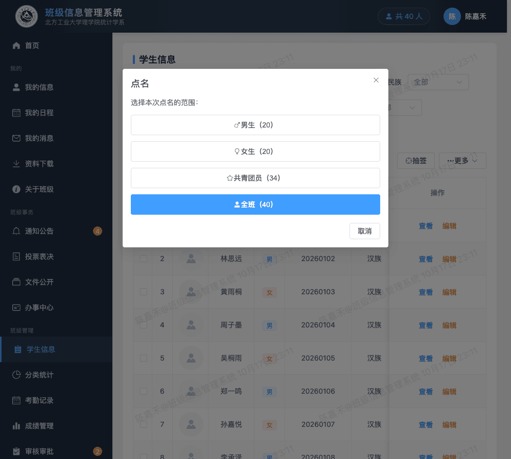

点名会跳过已批准请假的人并记为「请假」。每个人的状态可改为到、请假、无应答等；
结果逐人落库，可在「考勤记录」里查看、改状态、删除、写备注、导出 Excel。

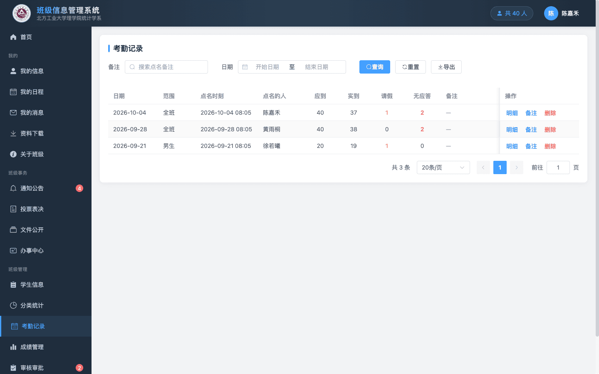

### 8.3 分类统计

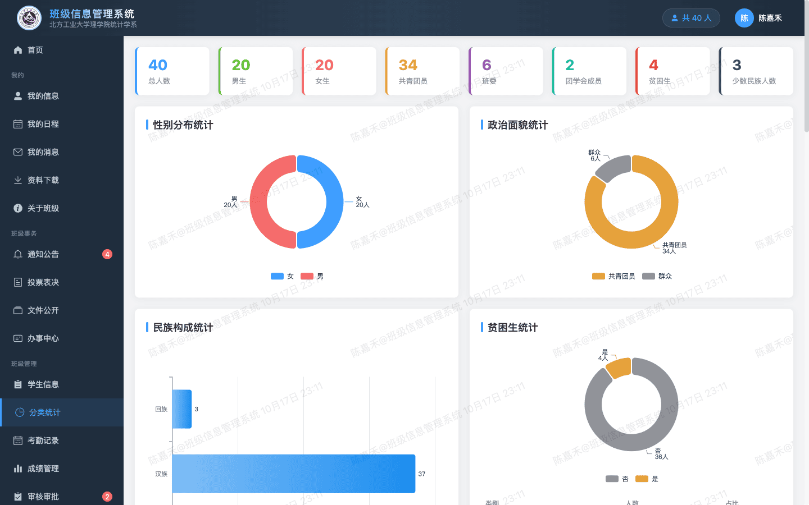

按性别、民族、政治面貌、宿舍、贫困生、高考分数段等维度统计，概览卡可以点开看名单。

### 8.4 成绩管理

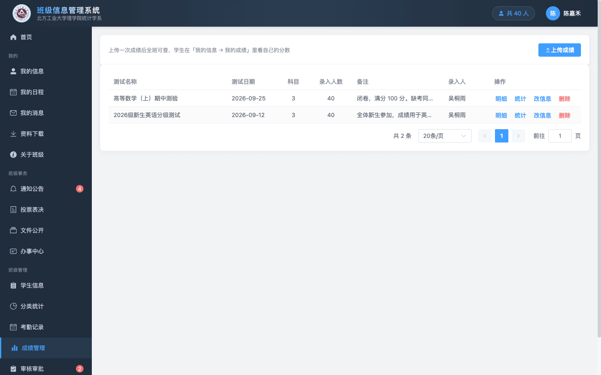

上传一份 Excel（第一行要有「学号」列，其余列都当科目）录入一次测验。
上传后先在预览里核对识别结果：哪列是学号、哪些列当科目，把「序号」「总分」这类列勾掉，
再填测验名称与日期。**学号对不上的人不入库**。

录入后可以逐格改分、增删科目、删除整次记录。分数之外允许填
「缺考 / 免修 / 缓考 / 违纪」。学生只在「我的成绩」里看自己的分数。

### 8.5 数据导出

班委提交导出申请，管理员审批通过后自动生成：

- 学生名单 Excel（列可勾选）；
- 每人一份个人信息表 PDF（带水印，打包成 zip）。

申请人自己下载；其他班委能看到申请列表与进度，但下不到别人的文件。

### 8.6 审核审批

- **信息修改申请**：班委审核。通过后改动生效，驳回要写理由。
- **办件**（请假 / 证明 / 通行证）：管理员批准或驳回。班委可以看列表与附件。

---

## 9. 系统管理

仅管理员可见。

### 9.1 账号与角色

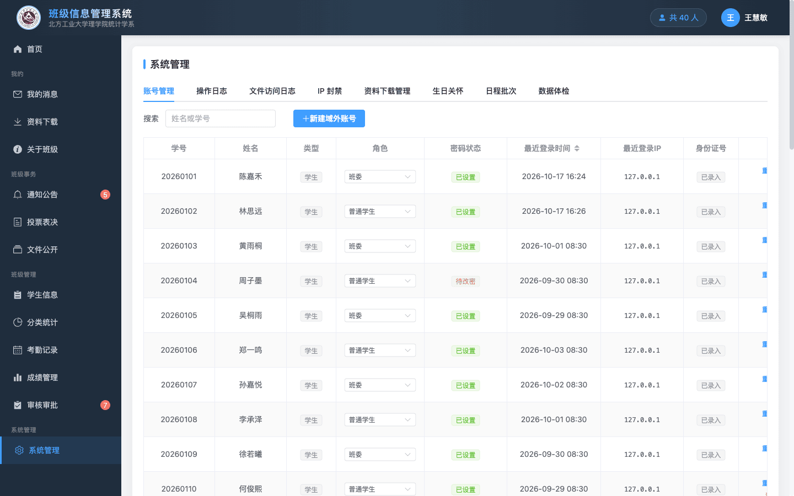

- 修改角色（普通学生 / 班委 / 管理员）；
- 重置密码为初始密码；
- 冻结 / 解冻账号；
- 清除一个人的全部通行密钥或二次验证；
- 新建域外账号（没有学号的外部人员，例如班导师），可登录、可审批。

每个学生建号时就会生成账号，密码规则见 [1.1](#11-密码登录)。

### 9.2 批量导入

- **导入学生 Excel**：第 1 行是表头，最少需要「学号」「姓名」两列；
  学号已存在就更新。日期列必须是真的日期格式。
- **批量导入照片**：传一个 zip，文件名含学号或与学生姓名完全一致即可自动匹配；
  认不出的可以手工指认，已有照片默认跳过、可勾选覆盖。

### 9.3 操作日志

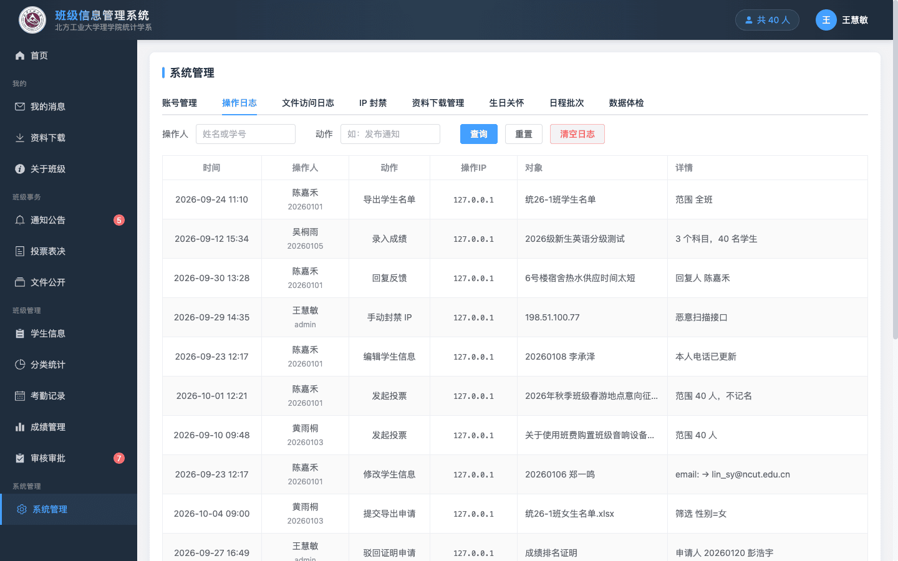

记录谁在什么时候做了什么（发布通知、审核办件、点名、导出名单等），
可按操作人与动作筛选。自动封禁不写操作日志，它的来由记在「IP 封禁」页。

### 9.4 文件访问日志与水印

记录谁在什么时候查看或下载了哪份公告 / 资料。含名单与审批记录的页面盖有
「姓名@班级 日期」水印，截图外流时可以据此溯源。

### 9.5 IP 封禁

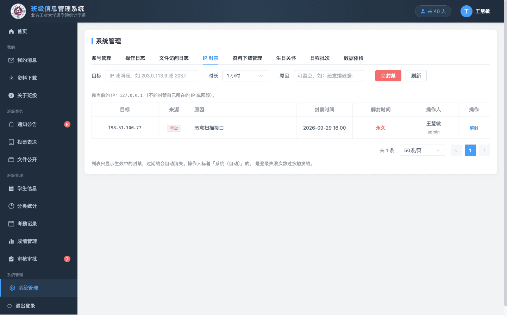

可以封单个 IP 或一个 CIDR 网段，时长 1 小时到永久。三条约束：
不能封自己当前所在的 IP；不能封与反向代理网段重叠的网段；已有的封禁只会延长。

### 9.6 资料下载管理

上传、改名、调整顺序、删除「资料下载」里的文件。可下载文件以这里的记录为白名单，
直接往服务器目录里放文件不会被识别。

### 9.7 生日关怀

有人过生日时首页显示祝福条幅，可给寿星推送祝福语、把当天生日汇总通知给指定账号。

### 9.8 数据体检

一键查出学生表里的脏数据：身份证缺失、非 18 位、校验位错、重复、与出生日期或性别
对不上；手机号与邮箱格式可疑；必填字段缺失；照片没传或文件丢失。
**只报告不改数据**，每条都能点进学生详情。

---

## 10. 消息通知

所有消息都会进站内信，这是**唯一必达**的渠道。额外的推送渠道：

| 渠道 | 怎么开 | 说明 |
|---|---|---|
| 浏览器通知 | 「通知设置 → 开启通知」并允许权限 | 需要 HTTPS；iOS 需先添加到主屏幕 |
| Bark | 填 Bark App 里的设备 ID | 手机推送，对境内网络友好 |
| 邮件 | 填通知邮箱 | 需要管理员配置 SMTP |
| Webhook | 填自己的地址 | 以 HTTP 请求推送，便于接入自动化 |

办件进度、新通知、审核结果、成绩发布、生日祝福都会按你的设置推送。
推送失败不会影响站内信。

---

## 11. 常见问题

**登录提示「学号或密码错误」**
先确认学号没有多余空格。初始密码是身份证号后 6 位；没填身份证号则是学号后 6 位。
仍不行请联系管理员重置。

**登录后要求填验证码，但没收到邮件**
先看「我的信息 → 账户设置 → 账号安全」里绑定的邮箱对不对；60 秒后可以点「重新发送」。
也可以使用一次性恢复码。恢复码丢失时请管理员清除二次验证。

**换了手机，通行密钥用不了**
密码仍然有效，用密码登录后到「账号安全」删掉旧钥匙，重新登记。不会操作就请管理员清除。

**投票投错了想改**
系统不支持改票。请在截止前联系发起人说明情况；若投票尚未结束，发起人可以结束并重新发起。

**下载的文件打不开 / 提示没有权限**
先刷新页面确认登录状态没有过期；仍不行请联系管理员检查文件是否已被删除或可见范围。

**手机收不到通知**
浏览器通知在 iOS 上必须先「添加到主屏幕」；Android / 桌面 Chrome 的推送走 Google 服务，
境内网络下可能不可达，建议改用 Bark。所有渠道都失败时，站内信仍然照常记录。

**页面上的班级名称、校徽不对**
这是部署配置，不是浏览器缓存。请联系管理员修改 `SITE_*` 环境变量并重建前端容器。
